<h1 align="center"></h1>

<p align="center"><b>Stop your AI agent from writing like every other AI.</b></p>

<p align="center">
  <a href="https://github.com/nocodeanish/write-without-ai-slop/actions/workflows/consistency.yml"></a>
  <a href="LICENSE"></a>
  <a href="https://github.com/nocodeanish/write-without-ai-slop/releases"></a>
</p>

AI text looks, feels and reads the same, and readers notice. This skill lists what not to do. It does not teach a style, so your agent keeps its own voice, or yours. No setup, and it does not ask questions mid-task. It is an agent skill: a folder with a SKILL.md file that agents read.

## See it work


<sub>An illustration of the example below, not a recording. All examples are invented. More in [examples](examples/before-after.md).</sub>

<details>
<summary>The same example as text</summary>

Before:

```
Here's the thing: shipping fast isn't just about speed, it's about trust.

Last month our team cut the checkout bug backlog from 42 to 9 in two weeks. Not just a win for engineering, but a win for customers, for the business, and for the future.

Agree? What's your biggest lesson?
```

After:

```
Shipping fast builds trust.

Last month our team cut the checkout bug backlog from 42 to 9 in two weeks.
```

The numbers stayed. The setup line, the "not just X" contrast, the group of three and the bait question went.

</details>

## Install



One line, for agents that support the skills installer:

```
npx skills add nocodeanish/write-without-ai-slop
```

In Claude Code 2.1.275 or later:

```
/plugin install write-without-ai-slop --marketplace nocodeanish/write-without-ai-slop
```

Or copy the folder into your agent's skills folder. For example, in Claude Code:

```
cp -r write-without-ai-slop ~/.claude/skills/
```

## How it works



- **Check:** ask it to check a draft. You get a list of problems, each with the quoted line and a short fix. Nothing is rewritten.
- **Rewrite:** give it a draft. You get the smallest edit that removes the problems, and a short list of what changed. Say the text will be pasted as it is, and you get only the text.
- **Write:** an agent that is about to write follows the rules while it writes.



## What it catches



- Invented facts, numbers, quotes and names.
- Chatbot leftovers such as "Certainly!", "I hope this helps" and unfilled placeholders.
- Sameness: five posts that open or end the same way.
- Patterns that matter in combination: "not X, but Y", groups of three, setups before the point, fake meaning at the end of a sentence, stacked fragments, piled-up hedges, vague sources, and more.



It has short pages for LinkedIn, X, email, website copy, docs and Slack.

## What it does not do

- It does not teach good writing or a house style.
- It does not detect AI. Detectors are unreliable: in one study, seven of them flagged 61% of essays by non-native English writers as AI, though people wrote them. This skill never says who wrote a text.
- One pattern proves nothing. It acts on combinations, and leaves a text alone when only one shows up. Editors call that *stet*: let it stand.
- It works on English. For other languages it checks only for invented facts, padding and sameness.

## Something went wrong?

Open a [bad output report](https://github.com/nocodeanish/write-without-ai-slop/issues/new?template=bad-output.yml). Paste your request, the text and the answer. Use invented text or text you are free to share.

To add a pattern or fix a page, see [CONTRIBUTING.md](CONTRIBUTING.md). Small first tasks carry the `good first issue` label.

## Your own voice

Give your agent a voice file or a short sample with your request. The skill keeps your phrasing and adds no voice of its own.

## Does it work?

The repo has 57 invented test cases in four sets, including cases where the right answer is to change nothing. Three models from one provider answered each case once, and a second model judged the answers without knowing which model wrote them. The exact checks (numbers, links, code, quotes, long dashes, chatbot leftovers) passed on all 171 answers. Judged passes were 54, 56 and 56 of 57.

The limits are real. The rules were shaped by failures on two of the four sets. One judge model read everything, and it shares a provider with the models tested. Other providers are untested. A difference of one or two cases is noise. Details, the five misses and how to run the tests yourself are in [evals/](evals/).

## Privacy

The skill is text files and one optional script, `scripts/check_text.py`. The test and check scripts in this repository are separate from the skill. All of them use only the Python standard library, and none makes a network call or collects data. The installer `npx skills add` is a separate tool: it collects anonymous usage data unless you set `DISABLE_TELEMETRY=1` or `DO_NOT_TRACK=1` (see its [README](https://github.com/vercel-labs/skills#telemetry)).

## Sources and versions

Where each rule comes from is in [docs/sources.md](docs/sources.md). Versions are in the [changelog](CHANGELOG.md).

## License

MIT. Created by Anish Gandhi. See `LICENSE`.

If this saved you an edit, a star helps other people find it.
